# Kiro

> Tamagotchi minimalista: dos ojos planos de color que sienten, se mueven y reaccionan, en una placa circular propia.
> **Producción Electrónica · IBERO Puebla** · Autores: **Alexa y Alessandro**

[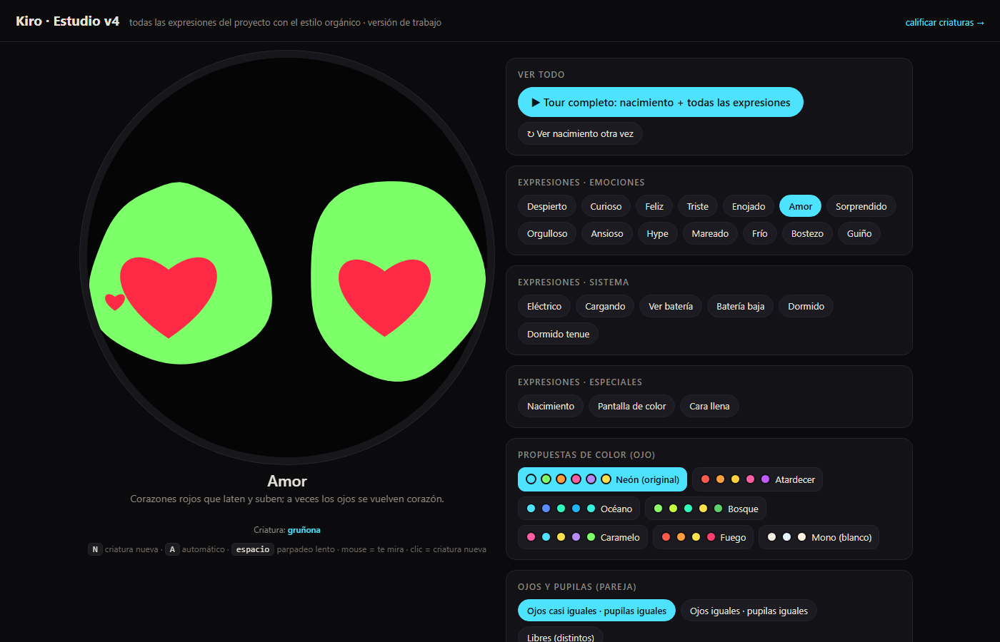](https://alesso-24.github.io/Kiro/estudio/kiro_v4.html)

## Demo en vivo (GitHub Pages)

**https://alesso-24.github.io/Kiro/**

| | |
|---|---|
| [Estudio de animaciones](https://alesso-24.github.io/Kiro/estudio/kiro_v4.html) | Las 23 expresiones, el nacimiento y un tour completo, interactivo |
| [Intros del logo KIRO](https://alesso-24.github.io/Kiro/estudio/intro_kiro_10.html) | 12 propuestas animadas; la elegida es la 12 |
| [Intro + nacimiento completo](https://alesso-24.github.io/Kiro/estudio/intro_completa.html) | Render exacto del firmware, ~46 s |
| [Documentación web](https://alesso-24.github.io/Kiro/capitulos/01-concepto.html) | Todos los capítulos, con navegación |

## Animaciones

Cada Kiro es **único**: al nacer se sortea una semilla de 32 bits (colores, forma de los ojos, pupila, espejo, escala, separación y personalidad) que se guarda en la memoria flash, así que al apagar y encender es la **misma criatura**. Las animaciones se diseñan y aprueban primero en el navegador y se portan 1:1 al firmware.

### Las 23 expresiones
Render del firmware real:

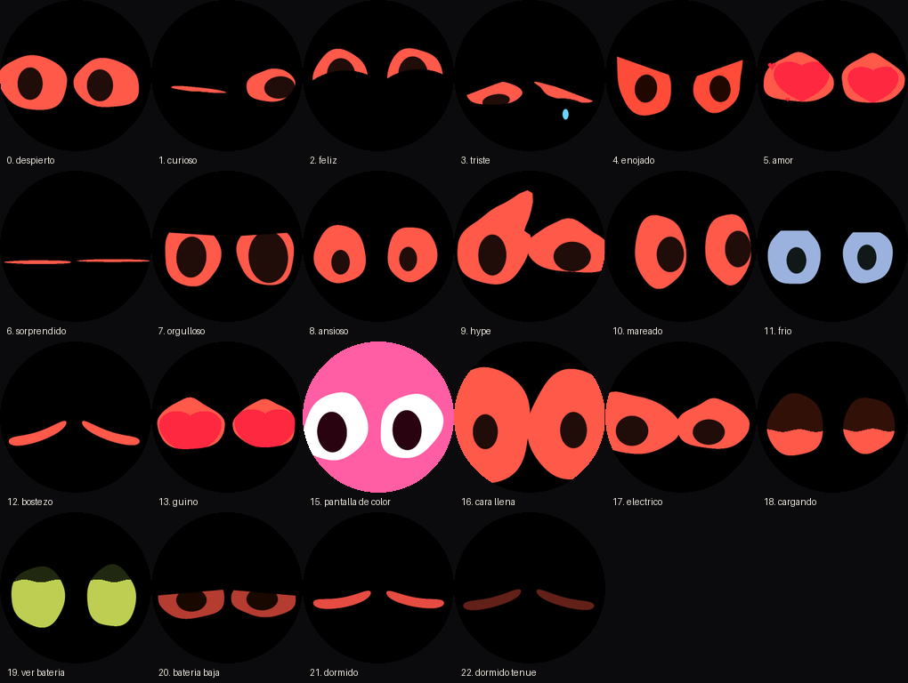

| Curioso | Amor | Enojado |
|---|---|---|
| 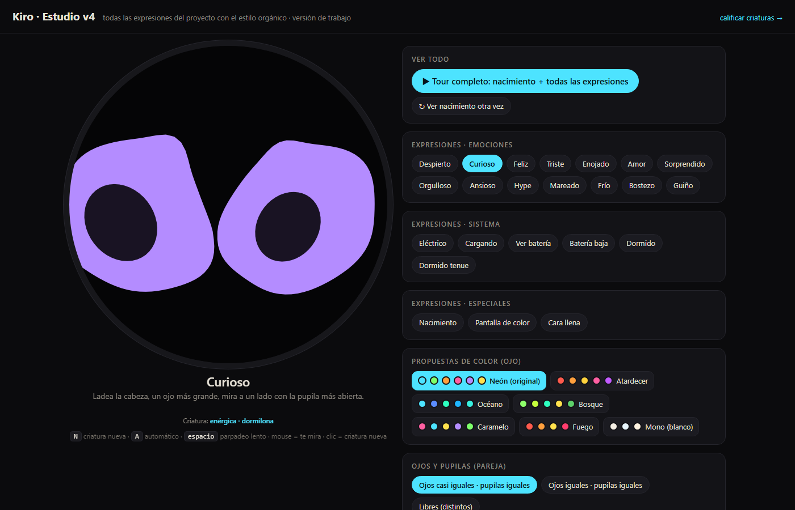 |  | 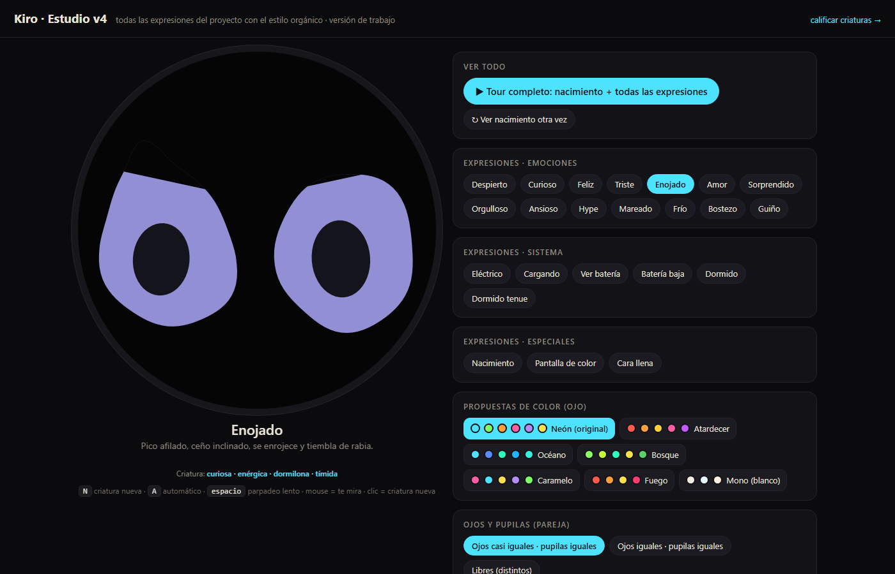 |

### Intro del logo y nacimiento
Al nacer, primero se ve el nombre **KIRO** (6.9 s): hilos blancos lo escriben en puntos, las letras mutan a saltos de color y forma, y se deshacen en partículas que se atraen a un punto; después los hilos del nacimiento salen de los bordes de la pantalla y empieza el nacimiento (~38 s).

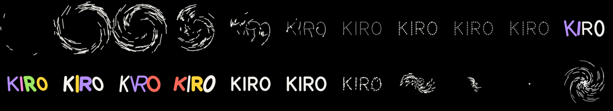

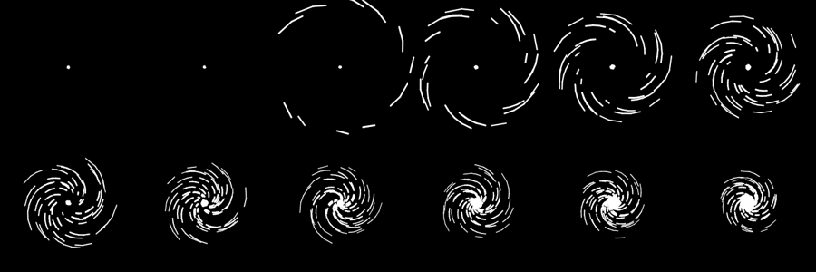

Las 12 propuestas de intro exploradas:

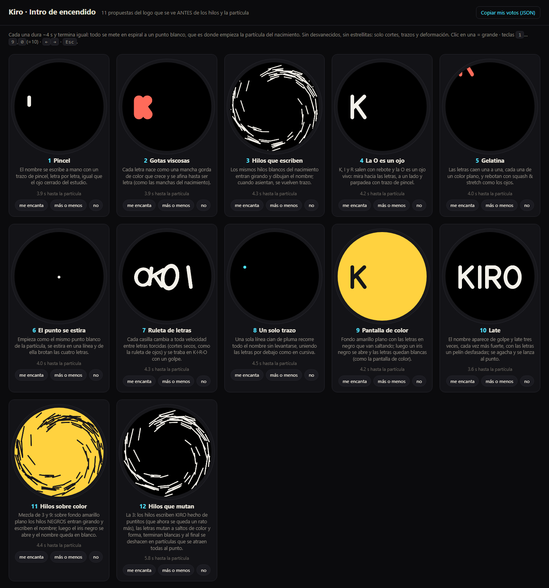

Detalle de cada expresión, estilo visual y reacciones previstas: [capítulo 8 · Animaciones](docs/08-animaciones.md).

## Firmware

Arduino (core Earle Philhower) sobre la XIAO RP2350 a 250 MHz. Doble framebuffer RGB565, DMA por SPI0 y envío solo de las filas que cambian: **50–60 fps**. `EyesCore.h` es el motor completo, sin dependencias de hardware, y se compila igual en el PC (arnés de pruebas).

| Control | Resultado |
|---|---|
| Azul corto | Siguiente emoción (curioso, feliz, amor, sorprendido, orgulloso, hype, cara llena, pantalla de color, enojado, triste, ansioso, frío, mareado, bostezo, batería baja, guiño, eléctrico) |
| Azul largo (0.8 s) | Ver batería |
| Verde (mantener) | Amor |
| Verde 5 s | Renacer: criatura nueva + intro + nacimiento, se guarda |

```
cd firmware
arduino-cli compile --fqbn rp2040:rp2040:seeed_xiao_rp2350:freq=250,opt=Optimize2 Kiro_Eyes
arduino-cli upload  -p COM6 --fqbn rp2040:rp2040:seeed_xiao_rp2350:freq=250,opt=Optimize2 Kiro_Eyes
```

Pinout de producción vs protoboard, serial de pruebas y rendimiento: [capítulo 7 · Firmware](docs/07-firmware.md).

## Hardware y PCB

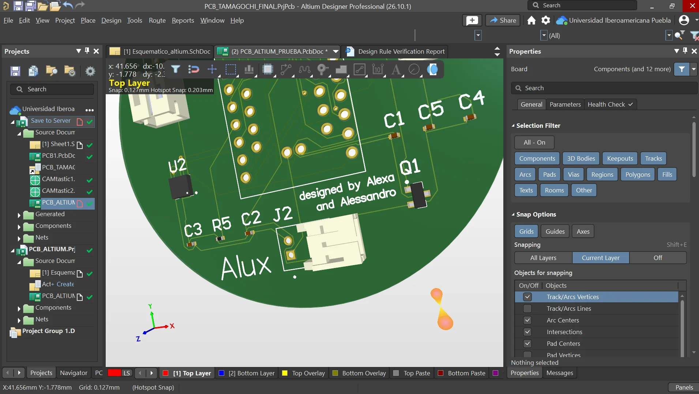

| | |
|---|---|
| MCU | Seeed XIAO RP2350 (Cortex-M33, sin WiFi/BT) |
| Pantalla | GC9A01 1.28" redonda, 240×240, SPI |
| Sensor | LIS3DHTR (acelerómetro 3 ejes, I2C, LGA-16) |
| Energía | LiPo 400 mAh · cargador integrado del XIAO · Q1 (P-MOSFET) apaga el display |
| PCB | 2 capas, ENIG, 1.0 mm, hecha en Altium Designer 26, fabricada en JLCPCB |

La placa enviada a fabricar (`PCB1`, "Alux V1"):

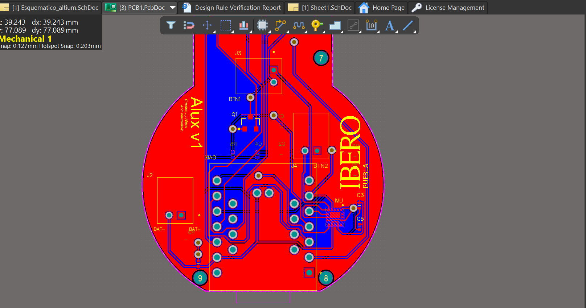

Esquemático y renders de los Gerbers:

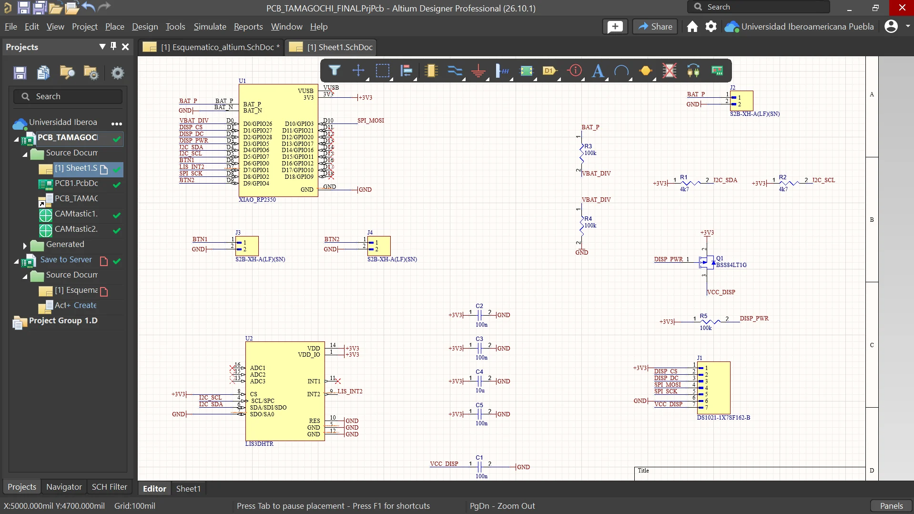

| Gerber top | Gerber bottom |
|---|---|
| 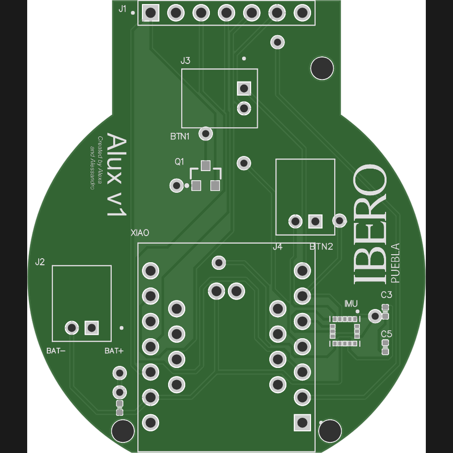 | 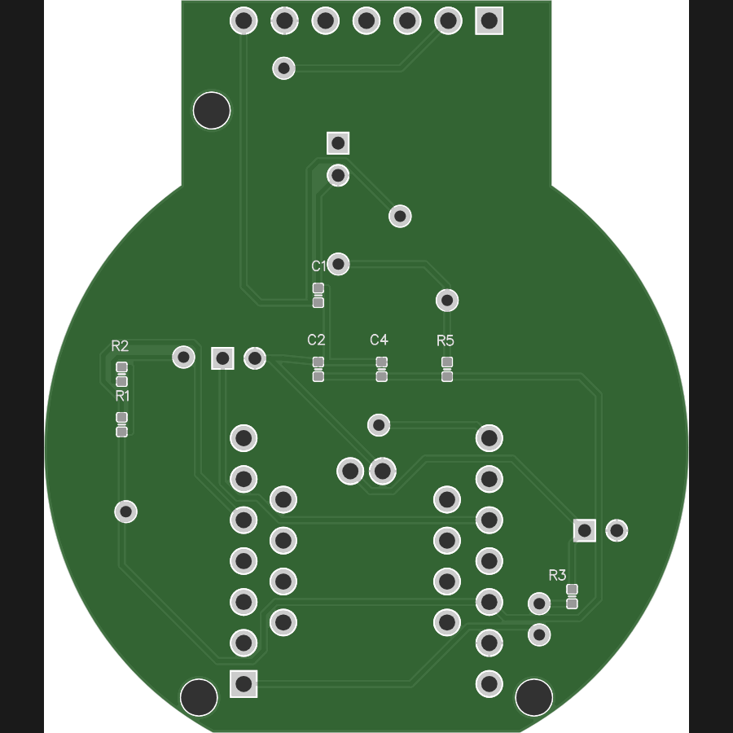 |

Los archivos reales de Altium (copia del proyecto), Gerbers y BOM están en [`hardware/`](hardware/).

## Documentación por capítulos

| # | Capítulo | Qué contiene |
|---|---|---|
| 1 | [Concepto](docs/01-concepto.md) | Qué es Kiro, objetivos, requisitos |
| 2 | [Hardware y BOM](docs/02-hardware.md) | Componentes, números LCSC, arquitectura de energía |
| 3 | [Esquemático](docs/03-esquematico.md) | Redes, mapa de pines verificado, por qué existe cada componente |
| 4 | [PCB](docs/04-pcb.md) | Forma, capas, taladros, DRC, renders de los Gerbers |
| 5 | [Fabricación](docs/05-fabricacion.md) | Paquete de Gerbers, parámetros de JLCPCB/LCSC, pedidos |
| 6 | [Ensamble](docs/06-ensamble.md) | Orden de soldado, verificaciones |
| 7 | [Firmware](docs/07-firmware.md) | Arquitectura, pinout de producción vs protoboard, compilar/subir |
| 8 | [Animaciones](docs/08-animaciones.md) | Las 23 expresiones, intro KIRO, nacimiento |
| 9 | [**Inconsistencias**](docs/09-inconsistencias.md) | Lo que no cuadra entre notas, archivos de Altium y firmware |
| 10 | [Pendientes y bitácora](docs/10-pendientes.md) | Qué falta y qué se hizo cuándo |

## Estructura del repositorio

```
Kiro/
├─ README.md                  este documento
├─ CLAUDE.md                  contexto técnico vivo (para trabajar con Claude Code)
├─ docs/                      documentación por capítulos, imágenes (docs/img) y sitio de GitHub Pages
├─ hardware/
│  ├─ pcb_altium/             COPIA del proyecto Altium PCB_TAMAGOCHI_FINAL (ver hardware/README.md)
│  └─ fabricacion/            Gerbers_Alux.zip (Oct 31), BOM de JLCPCB/LCSC
├─ firmware/
│  ├─ Kiro_Eyes/              sketch Arduino: Kiro_Eyes.ino + EyesCore.h (motor sin hardware)
│  └─ XIAO_GC9A01_Test/       prueba original pantalla + botones
├─ estudio/                   estudio web de animaciones (kiro_v4.html), intros, calificador
├─ herramientas/              arnés en PC, pruebas por serial y generador del sitio (build_site.py)
├─ respaldos/                 puntos de restauración del firmware (v37, v38)
└─ alternativa_genoma_clips/  sistema de animación anterior, documentado y NO usado
```

## Estado (2026-11-17)

- Animaciones y firmware probados en la XIAO + pantalla real (protoboard).
- PCB diseñada, ruteada (46/46 conexiones) y enviada a fabricar; componentes SMD pedidos a LCSC (según las notas del equipo).
- Siguiente: ensamblar la PCB, adaptar el firmware al pinout de producción y agregar sueño por movimiento, RTC, temperatura y vibraciones. Ver [pendientes](docs/10-pendientes.md) y las [inconsistencias detectadas](docs/09-inconsistencias.md) antes de ensamblar.

## Créditos e inspiración

Proyecto de Producción Electrónica, Universidad Iberoamericana Puebla. Diseño de hardware: Alexa y Alessandro. Firmware y animaciones: Alessandro, con asistencia de Claude Code.

Kiro está inspirado en [@lilguynet](https://www.instagram.com/lilguynet/) (Lil Guy / Starboy).
