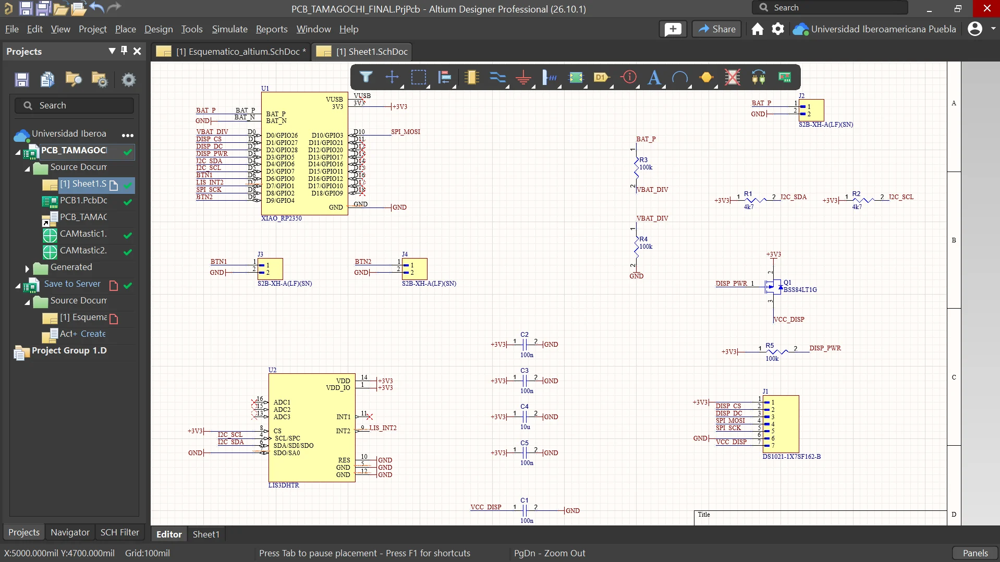
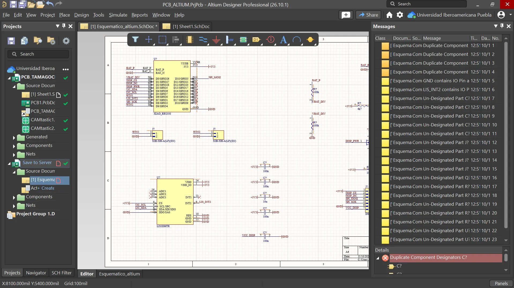

# 3. Esquemático

Archivo fuente: [`hardware/pcb_altium/Sheet1.SchDoc`](../hardware/pcb_altium/Sheet1.SchDoc) (Altium Designer 26, proyecto `PCB_TAMAGOCHI_FINAL`).



*Hoja única. Arriba: XIAO (U1) y conector de batería J2. Centro: divisor de batería (R3/R4), pull-ups I2C (R1/R2), botones (J3/J4) y el interruptor del display (Q1/R5). Abajo: LIS3DHTR (U2), bypass (C1–C5) y el header del display (J1).*

## Mapa de pines del XIAO RP2350 (verificado)

Verificado contra las etiquetas de red del `Sheet1.SchDoc` y contra el archivo de variante del core (`variants/seeed_xiao_rp2350/pins_arduino.h`).

| Pad XIAO | GPIO | Red | Conecta a | Función |
|---|---|---|---|---|
| D0 | **26** (ADC0) | `VBAT_DIV` | punto medio R3/R4 | Monitor de batería |
| D1 | 27 | `DISP_CS` | J1 pin 2 | Chip select del display (software) |
| D2 | 28 | `DISP_DC` | J1 pin 3 | Data/Command del display |
| D3 | **5** | `DISP_PWR` | gate de Q1 (+ R5) | Energía del display (LOW = ON) |
| D4 | 6 | `I2C_SDA` | LIS3DH SDA + R1 | I2C1 SDA |
| D5 | 7 | `I2C_SCL` | LIS3DH SCL + R2 | I2C1 SCL |
| D6 | 0 | `BTN1` | J3 pin 1 | Botón 1 (INPUT_PULLUP, otro pin a GND) |
| D7 | 1 | `LIS_INT2` | LIS3DH INT2 | Despertar por movimiento |
| D8 | 2 | `SPI_SCK` | J1 pin 5 | SPI0 SCK |
| D9 | 4 | `BTN2` | J4 pin 1 | Botón 2 (INPUT_PULLUP, otro pin a GND) |
| D10 | 3 | `SPI_MOSI` | J1 pin 4 | SPI0 MOSI (SDA del display) |
| BAT+ | — | `BAT_P` | J2 pin 1, R3 | Batería (pad inferior del módulo, al cargador interno) |
| 3V3 | — | `+3V3` | todo lo lógico | Salida del LDO del XIAO |
| GND | — | `GND` | | |

> **D3 = GPIO5 en el XIAO RP2350.** En el XIAO RP2040 D3 era GPIO29; en el RP2350 no. Las notas anteriores decían "GPIO29" — el hardware está bien (la red va al *pad* D3) pero el firmware debe usar `D3` / `5`. Ver [inconsistencia 1](09-inconsistencias.md).

## Header del display J1 (GC9A01, 7 pines)

| J1 pin | Red | Nota |
|---|---|---|
| 1 | `+3V3` | RST del display fijo en alto (sin reset por hardware) |
| 2 | `DISP_CS` | |
| 3 | `DISP_DC` | |
| 4 | `SPI_MOSI` | |
| 5 | `SPI_SCK` | |
| 6 | `GND` | |
| 7 | `VCC_DISP` | Salida de Q1 (3.3 V conmutados) |

## LIS3DHTR (U2, LGA-16) — conexiones según el esquemático

| Pin | Nombre | Conexión |
|---|---|---|
| 14 | VDD | +3V3 (+ C bypass) |
| 1 | VDD_IO | +3V3 (+ C bypass) |
| 8 | CS | +3V3 (modo I2C) |
| 4 | SCL/SPC | `I2C_SCL` |
| 6 | SDA/SDI/SDO | `I2C_SDA` |
| 7 | SDO/SA0 | GND → dirección I2C **0x18** |
| 9 | INT2 | `LIS_INT2` → D7 (GPIO1) |
| 11 | INT1 | **sin conectar** (salida push-pull; no ir a GND) |
| 10 | RES | GND (reservado, obligatorio a GND) |
| 5, 12 | GND | GND |
| 13, 15, 16 | ADC3/ADC2/ADC1 | sin conectar |

## Redes de energía

```
BAT_P ──┬── pad BAT+ del XIAO (cargador integrado)
        ├── J2 pin 1 (batería)
        └── R3 ── VBAT_DIV ── R4 ── GND            VBAT_DIV ──► D0 (ADC0)

+3V3 ───┬── Q1 source ── R5 ── Q1 gate (= DISP_PWR = D3)
        ├── LIS3DH VDD / VDD_IO / CS
        ├── R1 → I2C_SDA     R2 → I2C_SCL
        ├── J1 pin 1 (RST del display)
        └── C2, C3, C4, C5 → GND

Q1 drain ── VCC_DISP ── J1 pin 7 ── C1 → GND
```

## Verificación del esquemático (ERC)
La validación del proyecto en Altium (Project → Validate PCB Project) arroja mensajes que se corrigieron durante el diseño:



## Notas
- Los valores visibles en la hoja (4k7, 100k, 100n, 10u) son los **parámetros de valor**; los *comentarios/descripciones de biblioteca* de algunos símbolos dicen otra cosa (953 kΩ, 470 pF). Ver [inconsistencia 8](09-inconsistencias.md).
- El comentario de J2/J3/J4 dice `S2B-XH-A(LF)(SN)` pero la huella es `JST_S2B-PH-K-S(LF)(SN)` (PH, 2.0 mm). Es el comentario el que está mal.
