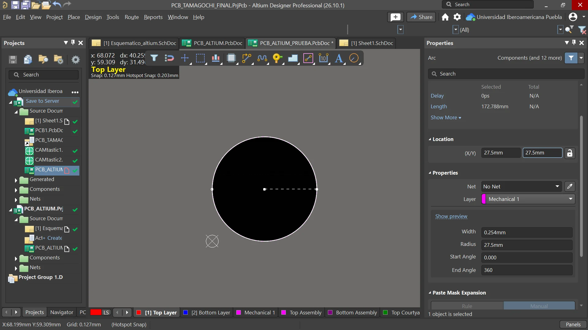
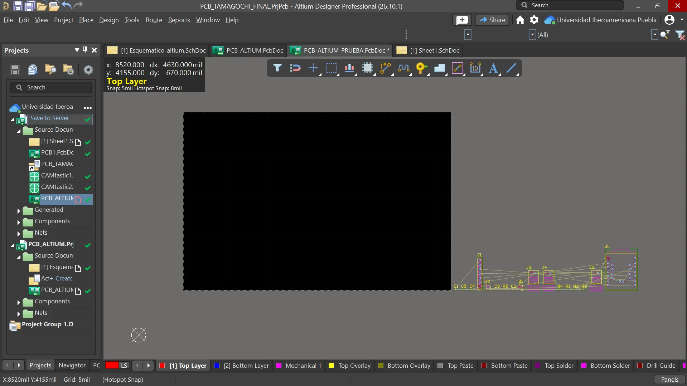
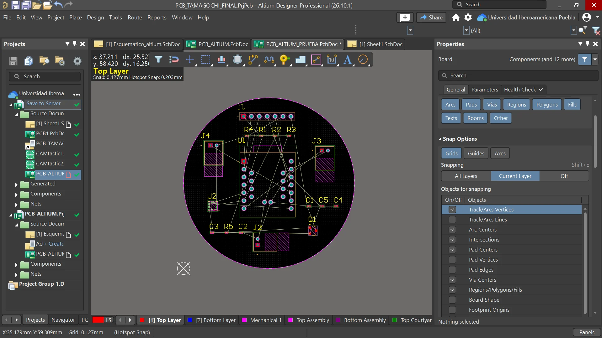
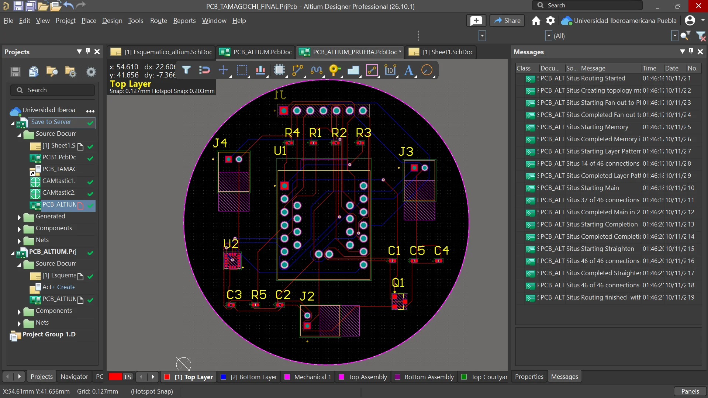
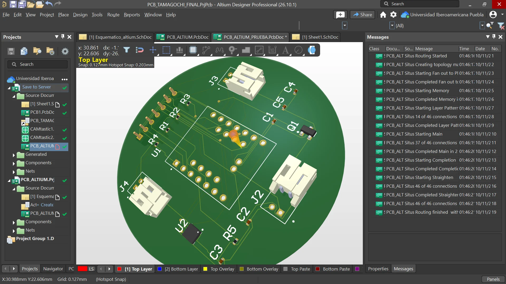
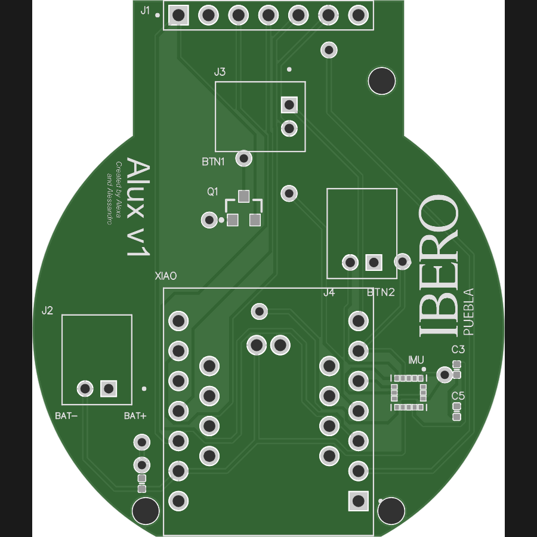
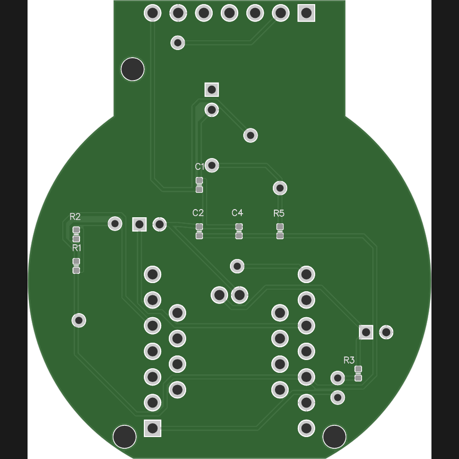
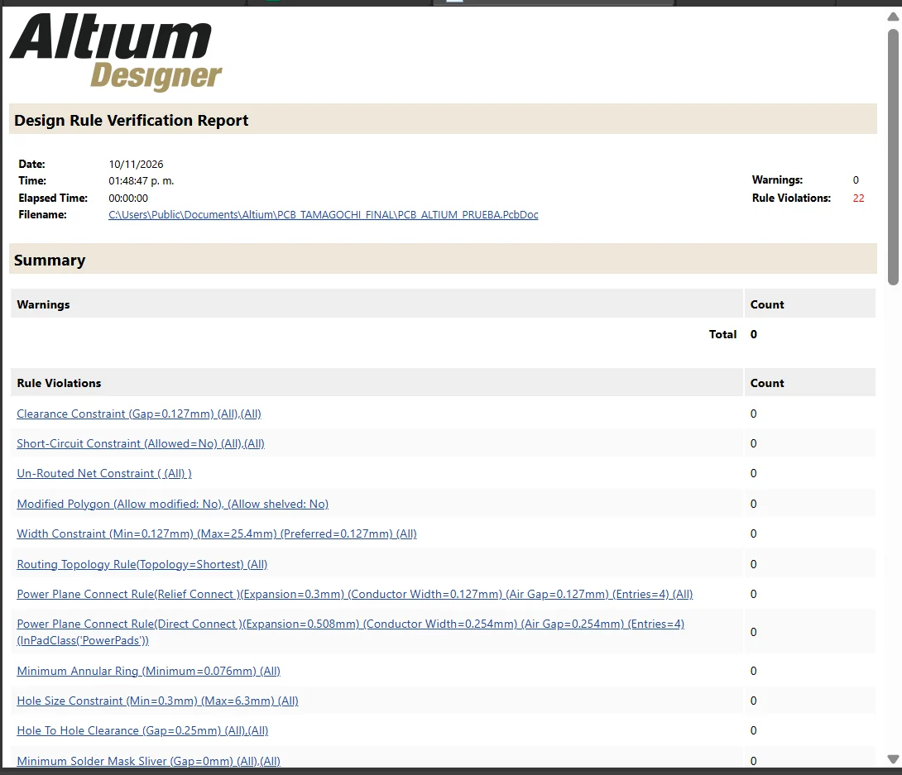

# 4. PCB

Archivos: [`hardware/pcb_altium/PCB1.PcbDoc`](../hardware/pcb_altium/PCB1.PcbDoc) (placa enviada a fabricar, 31-oct) y `PCB_ALTIUM_PRUEBA.PcbDoc` (placa de práctica/tutorial, 10-nov). Herramienta: Altium Designer Professional 26.10.1.

## Especificaciones

| Parámetro | Valor |
|---|---|
| Forma | Circular, ~55 mm de diámetro (radio 27.5 mm, capa Mechanical 1) — ver nota de contorno |
| Capas | 2 (Top / Bottom) |
| Espesor | **1.0 mm** (JLCPCB usa 1.6 mm por defecto: cambiarlo a mano) |
| Cobre | 1 oz (35 µm) |
| Acabado | **ENIG** (obligatorio para el LGA-16 de 0.5 mm), oro 1 U" |
| Máscara / serigrafía | Azul / blanca |
| Reglas | Archivo `.RUL` de JLCPCB (Replace all): clearance 0.127 mm, pista mín 0.127 mm, anillo mín 0.076 mm, agujero mín 0.3 mm |
| Taladros | 49: 9×0.711 mm, 6×0.8 mm, 24×1.0 mm, 7×1.02 mm (PTH) + 3×2.2 mm NPTH (tornillos M2) |
| Conexiones ruteadas | **46 / 46** (autoruteo Situs + ajuste manual) |

## Proceso de diseño (capturas)

**1. Forma circular** — círculo de radio 27.5 mm en Mechanical 1 → *Design → Board Shape → Define from selected objects*:

**2. Importar el esquemático** — *Design → Import Changes*: aparecen las huellas con las conexiones (líneas de rata):

**3. Acomodar componentes** — XIAO al centro, display (J1) en el borde, sensor y conectores alrededor:

**4. Ruteo** — autoruteo con Situs y ajuste a mano; el log de Altium confirma "46 of 46 connections":

**5. Vista 3D** del resultado ruteado y con la firma en la serigrafía ("designed by Alexa and Alessandro"):

> Las capturas 1–5 provienen de la práctica de Altium (placa `PCB_ALTIUM_PRUEBA`, misma metodología y mismo esquemático `PCB_TAMAGOCHI_FINAL`). La disposición final de componentes de `PCB1.PcbDoc` se ve en los renders de los Gerbers (abajo).

## Render de los Gerbers enviados (`Gerbers_Alux.zip`)

Generados con *gerbonara* a partir del paquete real de fabricación del 31-oct-2026:

**Top (cobre, máscara y serigrafía):**

**Bottom:**

Se aprecian: header del display **J1** arriba, **XIAO** al centro, **J2** (batería, `BAT+`/`BAT−`), **J3/J4** (`BTN1`/`BTN2`), **Q1**, el IMU (U2), el logo **IBERO Puebla** en la serigrafía y el texto **"Alux v1"** — el nombre anterior del proyecto.

> **Nota de contorno.** En el render el contorno (capa `.GM`) aparece como el círculo con una **pestaña rectangular** arriba, hacia J1. Las notas decían "circular 55 mm". Confirmar en el visor de JLCPCB que ese es el contorno deseado ([inconsistencia 7](09-inconsistencias.md)).

## Colocación (Pick & Place, 31-oct)

| Lado | Componentes |
|---|---|
| **Top** | J1 (header display), J2, J3, J4 (JST), U2 (LIS3DHTR), XIAO, Q1, R4, C3, C5 |
| **Bottom** | R1, R2, R3, R5, C1, C2, C4 |

(Fuente: `Pick Place for PCB1.csv`. Las notas mencionaban J1 en Bottom; ver [inconsistencia 6](09-inconsistencias.md).)

## DRC (Design Rule Check)

| Informe | Fecha | Violaciones | Detalle |
|---|---|---|---|
| `PCB1` (la enviada) | 31-oct | **26** | 20 de *Silk to Solder Mask* (serigrafía a 0.125 mm < 0.127 mm de pads 0402) + 6 de *Board Outline Clearance* (líneas de serigrafía del contorno del XIAO y de J1 a menos de 0.2 mm del borde de placa; una colisiona) — todas **estéticas** |
| `PCB_ALTIUM_PRUEBA` | 10-nov | 22 | 20 de *Silk to Solder Mask* + 2 de *Board Outline Clearance* (textos J1 y J4) |

Reglas eléctricas (Clearance, Short-Circuit, Un-Routed Net, Width, Annular Ring, Hole Size, Hole-to-Hole): **0 violaciones** en ambos informes.

Informes completos: `hardware/pcb_altium/Project Outputs for PCB_TAMAGOCHI_FINAL/Design Rule Check - *.html`.

## Salidas de fabricación
Ver [5. Fabricación](05-fabricacion.md).
