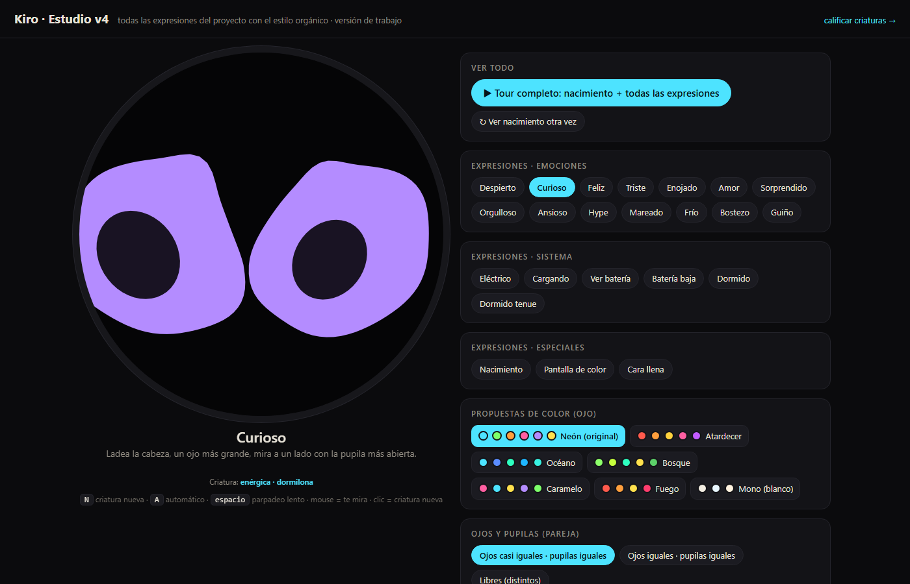
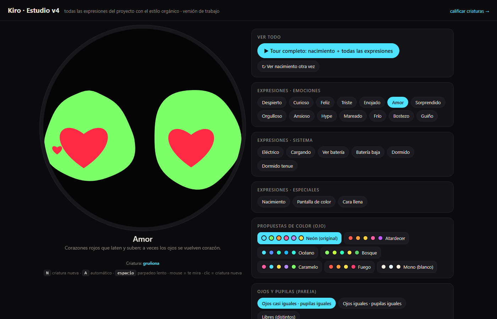
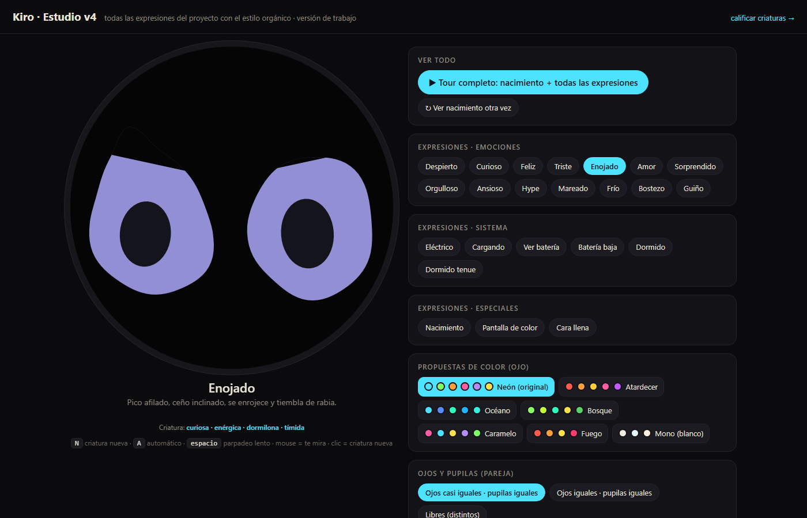
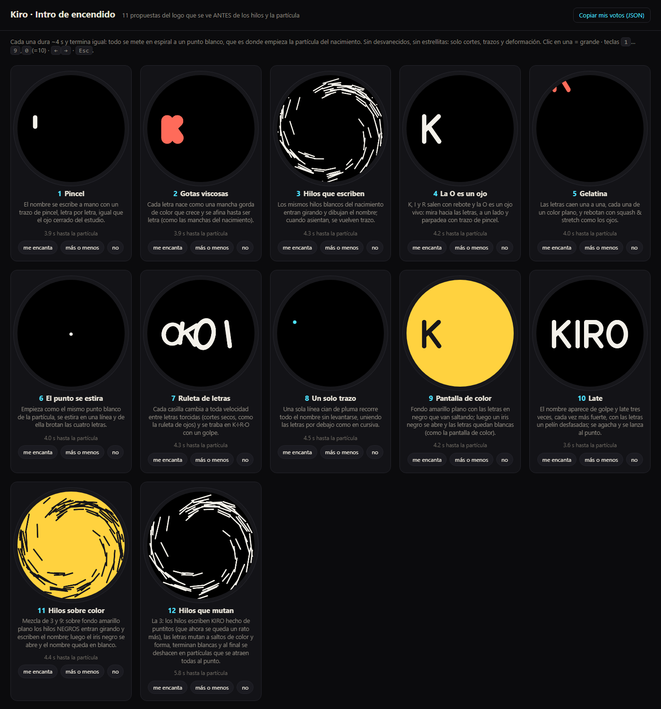
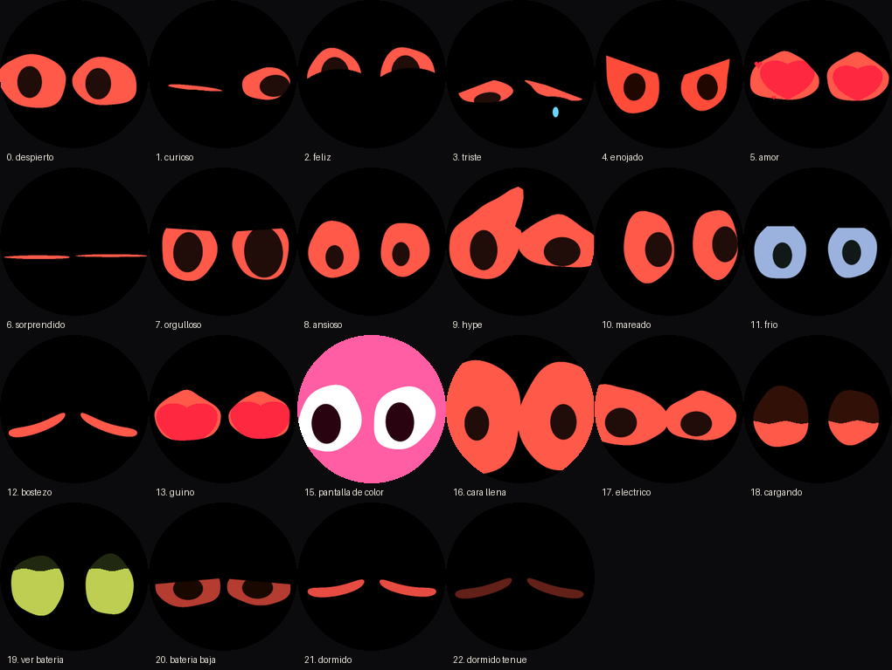
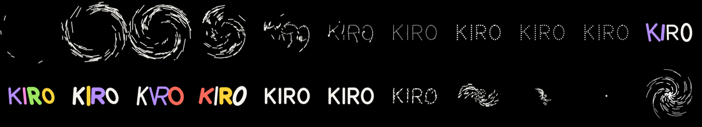
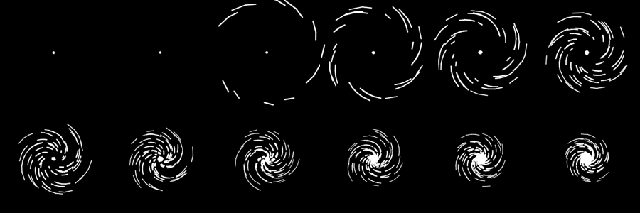

# 8. Animaciones

Las animaciones se **diseñan y aprueban primero en el navegador** ([`estudio/kiro_v4.html`](../estudio/kiro_v4.html), Estudio v4) y después se portan 1:1 al firmware (`EyesCore.h`). El mismo código del firmware corre en el PC (arnés) para generar las imágenes de esta página.

## Pruébalas en vivo

**[Estudio de animaciones (GitHub Pages)](https://alesso-24.github.io/Kiro/estudio/kiro_v4.html)** — interactivo: elige una expresión, cambia colores/ojos/pupilas, haz clic para una criatura nueva o pulsa «Tour completo». Capturas:

| Curioso | Amor | Enojado |
|---|---|---|
|  |  |  |

**[Intros del logo KIRO](https://alesso-24.github.io/Kiro/estudio/intro_kiro_10.html)** (12 propuestas; clic para verlas grandes, teclas 1–9 y 0):

**[Intro + nacimiento completo](https://alesso-24.github.io/Kiro/estudio/intro_completa.html)** — render exacto del firmware.

## Las 23 expresiones

*Render del firmware real a los 3.2 s de cada expresión (algunas capturas caen a mitad de un parpadeo o de una transición). Colores de ejemplo: cada criatura tiene los suyos.*

| ID | Expresión | Descripción |
|---|---|---|
| 0 | despierto | Reposo: óvalos suaves, respiración, parpadeo |
| 1 | curioso | Cabeza ladeada, un ojo más grande, mira a un lado |
| 2 | feliz | Mejillas y euforia |
| 3 | triste | Ojos caídos con lágrima |
| 4 | enojado | Recorte en V hacia el centro, picos hacia afuera, tono rojo |
| 5 | amor | Ojos de corazón y corazones rojos por los lados |
| 6 | sorprendido | Ojos que se inflan de golpe |
| 7 | orgulloso | Mirada superior, inflado |
| 8 | ansioso | Rebote con pupilas chicas |
| 9 | hype | Salta y late al compás |
| 10 | mareado | Los ojos chapotean contra los bordes |
| 11 | frío | Azul pálido, tiritando |
| 12 | bostezo | Curva caída ‿ con arrugas, estirada y suspiro |
| 13 | guiño | Un ojo en corazón/pincel |
| 14 | nacimiento | Ver abajo |
| 15 | pantalla de color | Fondo de un color plano + ojos de otro (11 combinaciones) |
| 16 | cara llena | Ojos enormes tipo domo |
| 17 | eléctrico | Ojos grandes con sacudida |
| 18 | cargando | Recipientes que se llenan |
| 19 | ver batería | Medidor rojo → naranja → amarillo → lima → esmeralda |
| 20 | batería baja | Párpados pesados, color apagado |
| 21 | dormido | Arcos de pincel que respiran |
| 22 | dormido tenue | Arcos apagados |

## Intro KIRO (6.9 s) + nacimiento

Cuando la criatura **nace o renace** (primer encendido o verde 5 s), primero se ve la intro del nombre y después el nacimiento. Con una criatura ya guardada, al encender **no** se ve (solo abre los ojos contenta).

1. **0–2 s** — hilos blancos entran girando y escriben KIRO hecho de puntos.
2. **1.9–2.6 s** — KIRO en puntos se sostiene.
3. **2.6–5.7 s** — las letras mutan a saltos de color, grosor e inclinación (acelera y frena), y terminan blancas con un golpe de gelatina.
4. **5.7–6.9 s** — las letras se deshacen en partículas que se atraen al punto blanco central.
5. **Transición** — los hilos del nacimiento salen de los bordes de la pantalla y se meten en espiral (3.4 s, gruesos y calmados al principio).

**Nacimiento (~38 s):** 16 hilos blancos → partícula-nube que se alimenta → explosión → dos manchas viscosas → ojos de nube → ruleta de siluetas y colores → cierre por deformación (el contorno se vuelve el trazo de pincel; el color cambia con el ojo cerrado) → abre los ojos.

Animación completa (render exacto del firmware, 30 fps, ~46 s): [`img/intro_completa_kiro.gif`](img/intro_completa_kiro.gif) y la página [`estudio/intro_completa.html`](../estudio/intro_completa.html).

Propuestas de intro exploradas (12): [`estudio/intro_kiro_10.html`](../estudio/intro_kiro_10.html). La elegida es la **12, "Hilos que mutan"**.

## Estilo
Siluetas de boceto (huevo de base plana + picos), 2 colores planos (ojo + pupila oscura del mismo tono), sin brillos ni degradados, pupilas con resorte propio, ojos asimétricos, ojo cerrado como trazo de pincel, **sin desvanecidos**.

## Estudio web y herramientas
- `estudio/kiro_v4.html` — todas las expresiones y el nacimiento (abrir en Chrome).
- `estudio/calificar_50.html` — hoja para calificar 50 criaturas base (guarda un JSON de votos).
- `alternativa_genoma_clips/` — sistema anterior (genoma + 141 clips aditivos), documentado y **no usado**.

## Reacciones previstas con la PCB
Con el LIS3DHTR se conectarán: sacudida suave → curioso, sacudida fuerte → mareo + enojo, quietud → sueño, tap×3 → amor, vibración rítmica → hype, temperatura → frío/calor. La lógica de movimiento probada con señales sintéticas está en `alternativa_genoma_clips/firmware_sistema_viejo/Motion.h` (se adaptará al motor actual).
